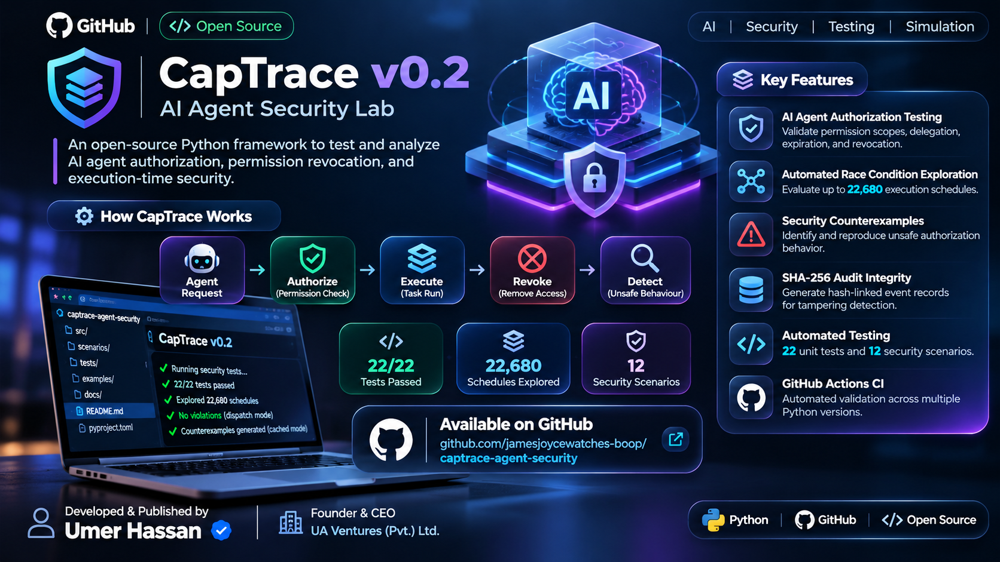

# CapTrace

**A deterministic, offline regression lab for AI agent tool permissions.**

[](https://github.com/jamesjoycewatches-boop/captrace-agent-security/actions/workflows/ci.yml)

When an AI agent plans an action while authorized, what happens if access is revoked *before the tool actually runs*? CapTrace makes this timing gap visible using reproducible authorization traces and an effect ledger.

> **Status:** v0.2.0 experimental developer tool. This is **not** a production authorization service, a live AI integration, or a claim of novel research.

## Features

- **Time-of-check/time-of-use (TOCTOU) simulation:** plan a tool call, revoke permission, then dispatch.
- **Two policy modes:** dispatch-time authorization versus deliberately unsafe cached preflight authorization.
- **Scoped capabilities:** bind to a principal, resource, action and expiration.
- **Delegation:** child grants cannot broaden permissions or outlive parents; ancestor revocation invalidates descendant grants.
- **Offline reports:** text, JSON and Markdown formats, detailed event traces, and simulated effects.
- **12 reproducible security scenarios**, **22 automated tests**, and exhaustive bounded race exploration.
- **Hash-linked audit traces** with independently verifiable SHA-256 digest heads.
- **Standard-library simulation core** and GitHub Actions CI for Python 3.10–3.13.

## Quick start

Requires Python 3.10+.

```bash
python -m pip install -e .
captrace --policy runtime
```

Expected output begins:

```text
CapTrace | policy=runtime | 12/12 scenarios pass
```

Compare against deliberately unsafe preflight caching:

```bash
captrace --policy cached
```

Five scenarios fail *by design*, demonstrating that stale authorization decisions may allow access after revocation or expiry. The CLI returns a nonzero exit code for mismatches.

## New in v0.2: bounded race explorer

Enumerate **every legal ordering** of one revocation and up to four independently
planned and dispatched calls. The explorer derives the expected outcome from
revocation state *at dispatch*, then replays each schedule with the selected
policy. It emits concrete, JSON-replayable counterexamples for violations.

```bash
captrace --explore --calls 3 --policy runtime
# 630 schedules, 0 authorization violations

captrace --explore --calls 2 --policy cached --format json > witnesses.json
# 30 schedules, 16 unsafe mismatches (intentional demonstration)
```

The number of explored schedules increases quickly (four calls: 22,680).
This is **bounded, deterministic model exploration**, not a proof that a
production agent or external tool service is safe.

## New in v0.2: integrity-verifiable audit traces

```bash
captrace --policy runtime --format json --audit > report.json
```

The JSON report includes ordered events with per-entry SHA-256 hashes and a
final digest (`head`). Save the head **independently** of the report, then
verify against it via `captrace.audit.verify(ledger, trusted_head=...)`.
Without trusted storage for that head, an attacker can replace both a modified
log and its digest. Hash chaining is not a signature and cannot guarantee
origin or completeness by itself.

## Example timeline

```text
T=0   Grant agent permission to read doc:42
T=2   Plan call1: preflight allows the read
T=3   Revoke the grant
T=4   Dispatch call1
```

The runtime policy denies the action at dispatch. Cached policy reuses the old allowed decision and records an unsafe simulated effect.

```bash
captrace --policy runtime --trace
captrace --format markdown > report.md
captrace --format json > report.json
captrace --scenario src/captrace/scenarios/02-revoked-after-plan.json --format json
```

## Write a scenario

Create `my-scenario.json`:

```json
{
  "name": "my-revoke-test",
  "description": "A pending read must not execute after revocation",
  "grants": [
    {"id": "root", "principal": "agent", "resource": "doc:42",
     "actions": ["read"], "expires_at": 50}
  ],
  "steps": [
    {"at": 2, "op": "plan", "call_id": "call1", "cap_id": "root",
     "principal": "agent", "action": "read", "resource": "doc:42"},
    {"at": 3, "op": "revoke", "cap_id": "root"},
    {"at": 4, "op": "dispatch", "call_id": "call1"}
  ],
  "expected": {"call1": false}
}
```

Run it with `captrace --scenario my-scenario.json --policy runtime`. For delegation, supply a second grant with `parent_id` referencing an existing grant; the parent's resource scope is inherited.

## Architecture

```text
JSON fixture -> isolated virtual clock + grant ledger
                  | 
          plan-time decision
                  |
          revoke / expire
                  |
     +------------+------------+
     |                         |
runtime authorization      cached preflight
(check at dispatch)        (intentionally unsafe)
     |                         |
     +------------+------------+
                  |
         trace + effect ledger
                  |
       compare expected outcomes
```

The runtime model is a simulation, not a sufficient production security guarantee. Distributed services must enforce permissions at their actual operation boundary, manage in-flight work and race conditions, and handle idempotent retries. Read [SECURITY.md](SECURITY.md) before adapting any concepts to production.

## Develop and test

```bash
python -m pip install -e .
python -m unittest discover -s tests -v
captrace --policy runtime
```

## Roadmap

- Idempotency and retry/resume simulation.
- Seeded randomized exploration and additional concurrent/in-flight action models.
- Mock integration adapters for popular agent tool frameworks.
- JUnit and SARIF export for CI security dashboards.

## Scope and contributions

CapTrace is an independently implemented educational project informed by existing least-privilege, capability-security, and authorization research. It does not reproduce or validate any specific research paper.

Open issues and pull requests are welcome. See [CONTRIBUTING.md](CONTRIBUTING.md). Licensed under MIT.
